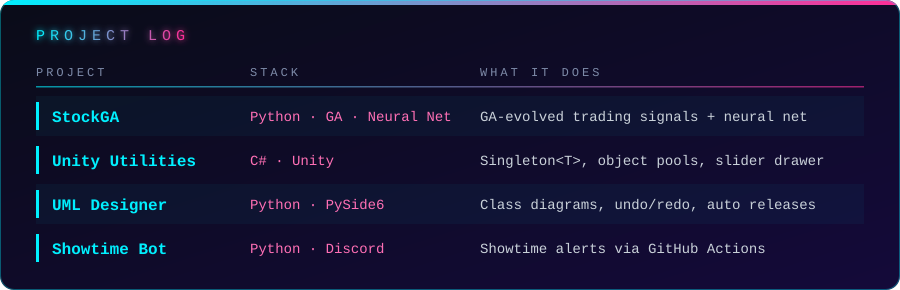

<!-- Repo name must match your username exactly: nbucci4325/nbucci4325 -->

  

## ⚡ About

I build gameplay systems and AI behavior, mostly in **C# and Unity**. I like tools that make other developers faster, and I enjoy applying algorithms, especially **genetic algorithms**, to real problems.

  

## 🧰 Tech

  
   
  

## 🚀 Projects

  

## 📈 Activity

  
   

<!--## 🛠️ Currently working on

- Replace this with 2–3 short bullets.

 

 

-->
