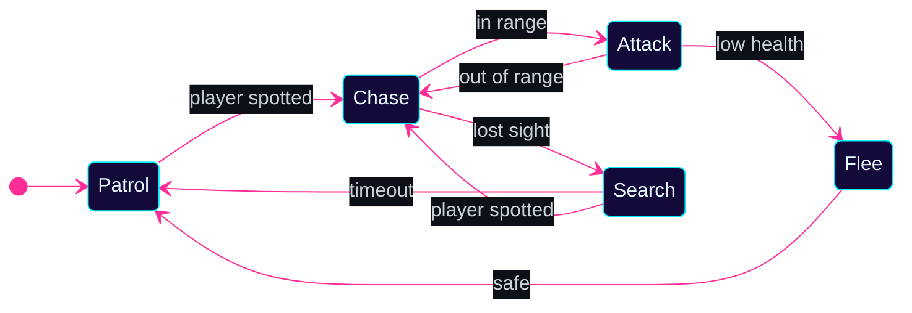
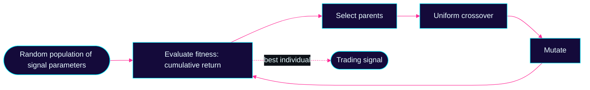
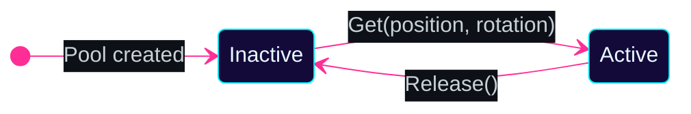

<!-- Repo name must match your username exactly: nbucci4325/nbucci4325 -->

<div align="center">



<a href="https://github.com/nbucci4325">
  
</a>

<a href="https://www.linkedin.com/in/YOUR-LINKEDIN"></a>
<a href="mailto:YOUR@EMAIL.COM"></a>


<br /><br />



</div>


## ⚡ About

I build gameplay systems and AI behavior, mostly in **C# and Unity**. I like tools that make other developers faster, and I enjoy applying algorithms, especially **genetic algorithms**, to real problems.

<details>
<summary><b>🎮 Press START: character sheet</b></summary>

<br />

```text
┌──────────────────────────────────────────┐
│  PLAYER      Nico                        │
│  CLASS       Game Programmer             │
│  GUILD       Brock / Niagara College     │
│  MAIN HAND   C# / Unity                  │
│  OFF HAND    Python                      │
│  SPELLBOOK   Genetic Algorithms, FSMs    │
│  QUEST       Land a co-op                │
│  STATUS      ● Open to party invites     │
└──────────────────────────────────────────┘
```

</details>


## 🧰 Tech

<div align="center">
  
  <br />
  
</div>


## 🧠 Game AI, in one diagram




## 🚀 Projects

<table>
  <tr>
    <td width="50%">
      <a href="https://github.com/nbucci4325/StockGA">
        
      </a>
    </td>
    <td width="50%">
      <a href="https://github.com/nbucci4325/UNITY-UTILITIES-REPO">
        
      </a>
    </td>
  </tr>
  <tr>
    <td width="50%">
      <a href="https://github.com/nbucci4325/UML-DESIGNER-REPO">
        
      </a>
    </td>
    <td width="50%">
      <a href="https://github.com/nbucci4325/SHOWTIME-BOT-REPO">
        
      </a>
    </td>
  </tr>
</table>

<details>
<summary><b>🧬 StockGA: how the evolution loop works</b></summary>

<br />



</details>

<details>
<summary><b>♻️ Unity Utilities: object pool lifecycle</b></summary>

<br />



</details>

<details>
<summary><b>📦 Everything else I've built</b></summary>

<br />

- **StockGA:** genetic algorithm in Python evolving trading signal parameters, integrated with a neural network pipeline.
- **Unity Utilities:** generic `Singleton<T>`, typed object pools and a min/max slider Inspector drawer.
- **UML Designer:** PySide6 desktop app with undo/redo and automated PyInstaller releases.
- **Showtime Bot:** Discord bot with alerts, deployed with GitHub Actions.

</details>


## 📈 Stats

<table>
  <tr>
    <td width="50%" align="center">
      
    </td>
    <td width="50%" align="center">
      
    </td>
  </tr>
</table>

<div align="center">
  
  <br />
  
</div>

<details>
<summary><b>🛠️ Currently working on</b></summary>

<br />

- Replace this with 2–3 short bullets.

</details>

<div align="center">
<br />

<br />

</div>
